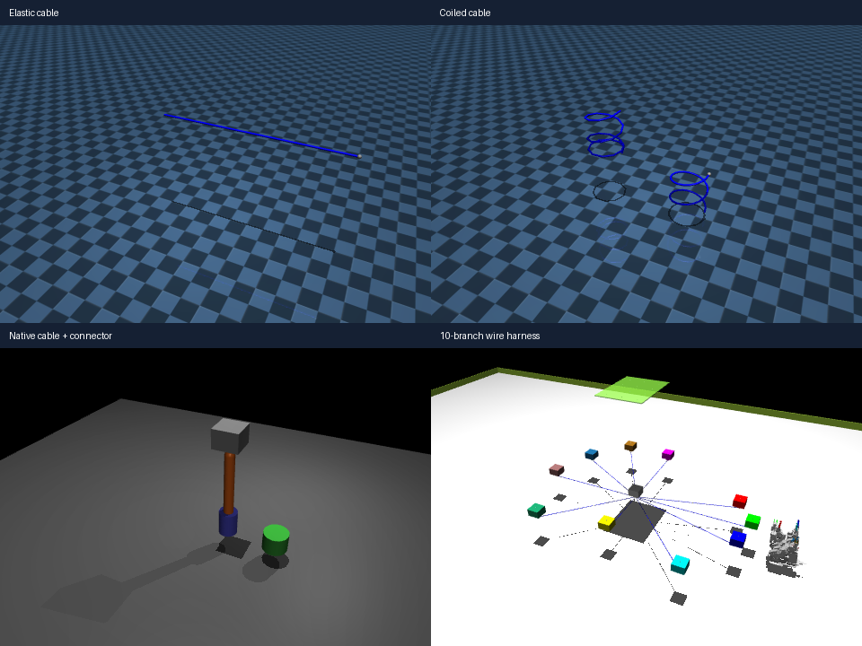

# 线缆与多分支线束模型

2026-10-26 已下载三组资源，共四个可直接打开的入口。来源固定提交、许可证和 SHA-256 见 `../third_party/cables_source_manifest.json`；本机验证见 `../third_party/cables_validation.json`。



| 模型 | 本地入口 | 物理形式 | 当前 GPU Warp |
| --- | --- | --- | --- |
| 官方弹性线缆 | `mujoco_elasticity/cable.xml` | 离散胶囊链与 elasticity.cable 插件，具有弯曲和扭转响应 | 不支持其 body 插件 |
| 官方螺旋线 | `mujoco_elasticity/coil.xml` | 两根螺旋弹性线及边界连接 | 不支持其 body 插件 |
| 短线缆与连接器 | `cable_chain/cable.xml` | 四段球关节线缆＋带球关节的末端连接器，弹簧与阻尼 | 已通过 4 世界并行步进 |
| 十分支线束场景 | `wire_harness/harness.xml` | 10 条线缆、连接器、工装及多夹爪，202 个等式约束 | 不支持其 body 插件 |

## 直接预览

在项目根目录运行下面任意一条命令，窗口为 CPU MuJoCo 仿真：

```powershell
# 官方弹性线缆。
uv run python -m mujoco.viewer --mjcf=models/cables/mujoco_elasticity/cable.xml
# 官方螺旋线。
uv run python -m mujoco.viewer --mjcf=models/cables/mujoco_elasticity/coil.xml
# 无插件短线缆，后续 GPU 任务建议从此类模型开始。
uv run python -m mujoco.viewer --mjcf=models/cables/cable_chain/cable.xml
# 十分支线束的完整工装场景。
uv run python -m mujoco.viewer --mjcf=models/cables/wire_harness/harness.xml
```

## 来源与用途

### MuJoCo 官方弹性模型

- 来源：[google-deepmind/mujoco](https://github.com/google-deepmind/mujoco/tree/3.17.0/model/plugin/elasticity)，固定 3.17.0 对应提交，与项目本机 MuJoCo 版本一致。
- Apache-2.0；原文件和插件说明保存在 `mujoco_elasticity/upstream/`。
- `cable.xml` 是受边界约束的线缆，并非一根完全自由的线。`coil.xml` 演示螺旋形状。
- 插件模拟近似不可伸长杆的弯曲和扭转，适合先在 CPU 研究材料参数；不是只显示外形的网格。

### 无插件短线缆链

- 来源：[poisson-labs/cable-insertion](https://github.com/poisson-labs/cable-insertion)，MIT。
- 原文件位于 `cable_chain/upstream/envs/assets/cable_scene.xml`；本地入口只引用原文件。
- 场景包含简化三轴移动夹持体、4 段约 3 cm 的线缆、末端连接器和插座外形。
- 它以球关节弹簧/阻尼近似柔性，没有材料级弯扭标定。插座外形不参与碰撞，不能据此声称已经实现有约束的真实插孔接触。
- 已在当前 MuJoCo Warp 中以 4 个世界运行 101 步，各世界响应不同控制，状态有限且不同；这只是兼容性检查，不是吞吐量或任务收敛验证。

### 多分支线束

- 来源：[KishanThummar007/WireHarness-MultiGripper-RL](https://github.com/KishanThummar007/WireHarness-MultiGripper-RL)，MIT。
- 下载了原 `Multi Gripper 4.xml`、其全部 17 个 STL 依赖、`S0_harness.npy`、README 和 LICENSE；未引入对方训练代码、依赖或预训练权重。
- 原 XML 第 558 行的 `size="0.005"rgba=...` 缺空格，原件仍保留。本地 `harness.xml` 只修正这一处语法并设置相对 `meshdir`，没有修改原拓扑、材料或控制器。
- 上游另一个 XML 版本引用了缺失资源，因此没有导入那个版本。
- 该模型包含多夹爪、旋转托盘、模块盒、连接器和线缆，是完整线束工作站参考，不是已经适配 FR3 的独立小模型。场景尺度、工装和关节数量需要按实际任务裁剪。
- `S0_harness.npy` 是上游预成形状态快照；这里只检查了 NPY 头部（3377 个 float64），没有加载到本地仿真。预览显示 XML 初始状态，不能把它当作已经复现上游完整重置流程。

## 验证与接入边界

本机 MuJoCo 3.17.0 中，四个模型均已加载并运行 100 个物理步，无数值警告，qpos/qvel 均为有限值。此检查不保证长时间稳定、材料准确度或复杂抓取表现。

官方线缆、螺旋线和十分支线束在当前 Warp 的 `put_model` 阶段明确报 `Body plugins not supported.`，不能直接用于本项目现有 GPU PPO；不要通过删除插件来声称保持了相同材料行为。

无插件短线缆链可作为 GPU 起点，但当前 `ReachEnv` 仍按 FR3 的 9 个关节和原到点任务编写。这里只导入并验证了独立资源，没有将线缆加入 FR3 场景、修改观测/奖励，或训练线束抓取/布线策略。接入时还需重新设计连接、碰撞缓冲区、初始状态、端点观测与任务目标。
